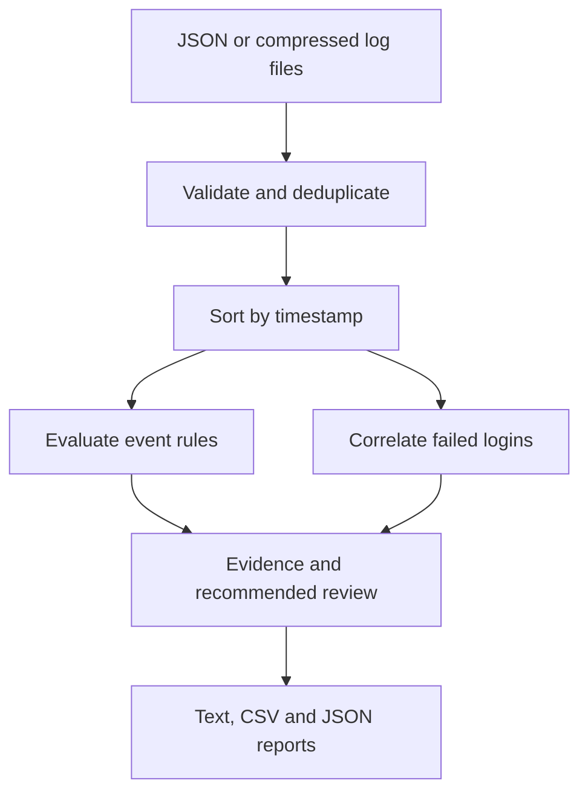

# AWS Cloud Log Analysis with Python


A portable, offline tool that turns AWS CloudTrail JSON records into security findings with supporting evidence and suggested investigation steps.

**Portfolio project · Synthetic data · Python standard library · No AWS account required**

## At a glance

- **Security:** AWS CloudTrail triage, IAM privilege changes, MFA gaps, root activity, logging changes and login bursts.
- **Engineering:** Python 3.10+, unit tests, GitHub Actions CI, JSON/CSV/text reports, no external dependencies.
- **Demo:** 15 synthetic events → 5 findings (4 High, 1 Medium); a clean baseline → 0 findings.
- **Run:** `python analyzer.py data/sample_cloudtrail.json` then inspect `reports/summary.txt`.
- **Verify:** `python -m unittest discover -s tests -v`.
- **Important:** Offline simulation with synthetic data; not a live AWS security monitoring deployment.

## Problem and result

A raw audit log records individual actions, but reviewing every record manually makes suspicious patterns difficult to spot. This project parses log files, applies five documented detection rules, correlates repeated failed logins, and writes text, CSV, and JSON reports for analyst review.

The included mixed dataset contains **15 unique events**. The default run produces **5 findings: 4 High and 1 Medium**, covering all five rules. The clean dataset produces no findings. These are controlled demonstration results, not measurements of real-world detection accuracy.

## Quick start — Windows / VS Code

1. Clone this repository or download its ZIP from GitHub, then open the `cloud-log-analysis` folder in VS Code.
2. Open **Terminal → New Terminal** and run:

```powershell
py --version
py analyzer.py data/sample_cloudtrail.json
```

Python **3.10 or newer** is required. No `pip install`, API key, cloud credentials, or AWS resources are needed. On systems where `py` is unavailable, use `python` or `python3`.

Open `reports/summary.txt` to inspect the findings. JSON retains structured evidence; CSV supports spreadsheet review.

```powershell
# Confirm benign activity produces no findings
py analyzer.py data/normal_cloudtrail.json --output local-reports/normal

# Analyze a directory of .json and .json.gz files recursively
py analyzer.py data --output local-reports/batch

# Change the failed-login correlation threshold and time window
py analyzer.py data/sample_cloudtrail.json --threshold 3 --window-minutes 5 --output local-reports/custom

# Run the automated checks
py -m unittest discover -s tests -v
```

Run commands from the project root. An invalid file or invalid configuration exits with code 2. Valid analysis exits with code 0, whether findings are present or not. Malformed individual records are skipped with warnings in the reports. Invalid JSON/envelopes stop the run before new reports are written; an earlier report in the destination may still exist.

## Detection rules

| ID | Severity | Trigger | Key limitation / benign explanation |
| --- | --- | --- | --- |
| ROOT_ACTIVITY | High | `userIdentity.type` is `Root` | Includes failed attempts; authorized account maintenance can be legitimate. |
| NO_MFA_LOGIN | High | Successful IAM/root `ConsoleLogin` with explicit `MFAUsed: No` | Missing MFA fields and federated identities are not treated as proof of no MFA. |
| LOGGING_CHANGE | High | CloudTrail `StopLogging` / `DeleteTrail`, without `errorCode` | Approved trail retirement may be legitimate; denied calls do not trigger this rule. |
| ADMIN_POLICY | High | IAM user/role/group attachment of exact AWS `AdministratorAccess` ARN, without `errorCode` | Authorized administrator provisioning can trigger it; custom/inline policies granting equivalent privileges are outside scope. |
| LOGIN_BURST | Medium | 5 failed console logins for the same account, actor, and IP within 10 minutes | Password mistakes and shared IPs require investigation; distributed attacks are outside scope. Only explicit failed responses or selected authentication error codes count. |

Severity is a project triage choice, not an AWS classification. Findings are signals for human review and do not establish compromise. A single event can produce several findings.

Correlation sorts events by timestamp, uses an inclusive time window, and emits one alert per non-overlapping threshold-sized cluster. It resets that cluster after an alert to avoid emitting an alert for every subsequent failure. Correlation is within the supplied input only; state is not retained between runs. Missing correlation identities generate warnings rather than merging unknown actors. Events with the same account and event ID are deduplicated across files; missing IDs cannot be deduplicated.

## Workflow



## Repository contents

- `analyzer.py` — loading, validation, rules, correlation, reports and command-line entry point.
- `data/sample_cloudtrail.json` — mixed synthetic scenario with positive and negative controls.
- `data/normal_cloudtrail.json` — clean baseline.
- `reports/` — reproducible example outputs for the mixed scenario.
- `tests/test_analyzer.py` — regression and command-line tests.
- `docs/INVESTIGATION.md` — example analyst interpretation and validation record.
- `docs/WALKTHROUGH.md` — concise code explanations and interview preparation.

## Scope and tradeoffs

This is an offline learning and portfolio project, not a deployed monitoring service. It does not collect logs, call an API, query AWS, send alerts, or modify resources. Reading existing JSON builds the parsing and analysis foundation; live collection can be a future extension. Inputs support a CloudTrail `Records` envelope or a bare event array, optionally gzip compressed. CloudTrail Lake, LookupEvents wrappers, JSON Lines, and other cloud providers are not supported.

Processing loads the supplied records into memory to sort and correlate across files. Very large datasets need streaming or a query engine. Timestamp/name/source fields receive basic validation; this is not a full CloudTrail schema validator. It does not evaluate arbitrary IAM policies, attribute business intent, identify every threat, or establish that a recorded request achieved its intended downstream effect. No allowlist or asset criticality tuning is implemented.

All included activity is fabricated. Account IDs, identities, and documentation IP addresses are demonstration values. Keep real logs in `private-data/` and outputs in `local-reports/` (both ignored by Git); review for sensitive data before publishing anything. CSV output guards against spreadsheet formula interpretation of untrusted fields.

## Continuous integration

GitHub Actions runs the standard-library unittest suite on pushes and pull requests to `main`, using Python 3.10 and 3.12. Check the **Actions** tab for results. A green badge reflects the most recent applicable workflow result; it does not prove detection accuracy or production readiness.

## Validation

Run `py -m unittest discover -s tests -v`. The suite covers unrelated login errors and explicit failed-login responses, plus exact sample findings, clean and failed-action controls, event-source checks, MFA ambiguity, deduplication, unordered input, time boundaries, account isolation, malformed records, gzip, CSV safety, report generation and CLI errors. Expected sample result: 15 analyzed events and 5 findings. See `docs/INVESTIGATION.md` for the verified run.

## Future improvements

- Add a read-only AWS collection module with separate credential handling and tests.
- Add configurable allowlists and severity tuning based on account context.
- Detect additional privilege changes and distributed authentication attacks.
- Add incremental state, larger-dataset support and a scheduled execution option.

## References

- [CloudTrail record contents](https://docs.aws.amazon.com/awscloudtrail/latest/userguide/cloudtrail-event-reference-record-contents.html)
- [AWS console sign-in event examples](https://docs.aws.amazon.com/awscloudtrail/latest/userguide/cloudtrail-event-reference-aws-console-sign-in-events.html)
- [IAM and STS CloudTrail integration](https://docs.aws.amazon.com/IAM/latest/UserGuide/cloudtrail-integration.html)

## Project Development

This project was developed as part of my hands-on learning in cloud security, Python programming, and security automation. It demonstrates how AWS CloudTrail logs can be analyzed to identify suspicious activity, generate security findings, and support incident investigations.
